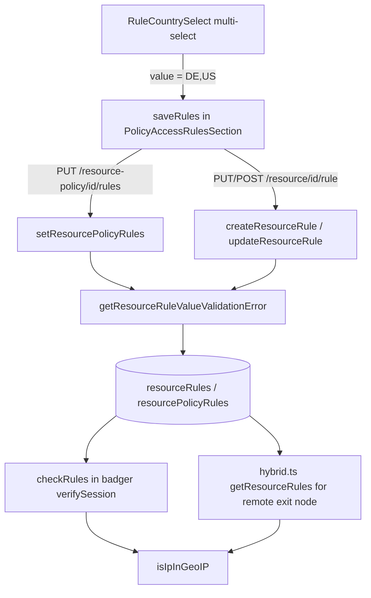

# Fix: multi-location / region selection on the block-list

## Symptom

A rule of **Block Access** + **Country Is Not** + **DE, US** is saved and enabled,
but it blocks nobody. Expected (per report): clients in **DE** and **US** get
access, everyone else is blocked.

## How the feature is wired



The intended semantics already exist and are correct in
[`checkRules`](../server/routers/badger/verifySession.ts:1711):

```ts
const inCountry = await isIpInGeoIP(ipCC, rule.value);
const matched = rule.match === "COUNTRY" ? inCountry : !inCountry;
```

With a clean value `"DE,US"`, `DROP` + `COUNTRY_IS_NOT` blocks everyone except
DE and US. So the evaluation math is right — the **stored value is not clean**,
and **one evaluation path ignores the match type entirely**.

## Root cause 1 — "ALL COUNTRIES" is selectable in the new multi-select and swallows the list

This is the bug that reproduces the screenshot.

- [`server/db/countries.ts:2-5`](../server/db/countries.ts:2) — `ALL` is the
  **first entry** of the `COUNTRIES` array, with the comment
  `THIS IS AN INVALID CC SO IT WILL NEVER MATCH`.
- [`RuleCountrySelect`](../src/components/resource-policy/PolicyAccessRulesTable.tsx:280)
  renders **every** `COUNTRIES` entry as a toggleable `CommandItem`, so `ALL`
  (shown as 🌐 ALL COUNTRIES) is just another checkbox in the list.
- [`toggle()`](../src/components/resource-policy/PolicyAccessRulesTable.tsx:250)
  appends to the list with no exclusivity, so picking ALL then DE then US yields
  the stored value **`"ALL,DE,US"`**.
- [`isValidCountryList`](../server/lib/validators.ts:132) accepts it, because
  `code === "ALL" || ...` short-circuits per item. It saves with no error.
- [`isIpInGeoIP`](../server/routers/badger/verifySession.ts:1767) —
  `if (codes.includes("ALL")) return true;` → **every** IP is "in country".
- Therefore `matched = !inCountry` is **always `false`** for `COUNTRY_IS_NOT`
  → the rule never fires → nobody is blocked.
- Bonus: the local/CGNAT guard at
  [`verifySession.ts:1704-1709`](../server/routers/badger/verifySession.ts:1704)
  keys off `countryCodes.includes("ALL")`, so LAN / CGNAT clients are `continue`d
  as well.

`ALL` was designed for the old single-select, where it was the only sane way to
say "every country". In a multi-select it is a trap: it is mutually exclusive
with every other choice, and it silently inverts a `COUNTRY_IS_NOT` rule into a
no-op.

## Root cause 2 — the remote exit node path drops `COUNTRY_IS_NOT` entirely

For any org served by a **remote / hosted exit node**, the rules are not
evaluated by `checkRules` — they are shipped to the node by
[`GET /resource/:id/rules` in hybrid.ts](../server/private/routers/hybrid.ts:1781).

[`hybrid.ts:1879-1892`](../server/private/routers/hybrid.ts:1879) has a
backward-compat shim that renames `COUNTRY` → `GEOIP` for nodes with
`secondaryVersion < 1.1.0` (or unset) — and **no handling for
`COUNTRY_IS_NOT` at all**.

`COUNTRY_IS_NOT` is a new match type: the 1.12.0 migration only renamed
`GEOIP` → `COUNTRY`, so `COUNTRY_IS_NOT` never existed on older nodes. An old
node that receives `match: "COUNTRY_IS_NOT"` matches no branch and **silently
ignores the rule**. On that deployment the block-list does nothing, with no
error anywhere.

## Root cause 3 — blueprint paths are not at parity with the API paths

`AGENTS.md` requires the blueprint to be able to do everything the API can do.
It currently cannot, and validates less than the API:

| Path | country / country_is_not | region | asn | normalizes value |
| --- | --- | --- | --- | --- |
| API [`getResourceRuleValueValidationError`](../server/lib/validators.ts:155) | ✅ | ✅ list | ✅ | — |
| [`publicResources.ts` `validateRule`](../server/lib/blueprints/publicResources.ts:1587) | ❌ missing | ⚠️ single-id only | ❌ missing | ✅ [`getRuleValue`](../server/lib/blueprints/publicResources.ts:1575) |
| [`resourcePolicies.ts`](../server/lib/blueprints/resourcePolicies.ts:60) | ❌ missing | ❌ missing | ❌ missing | ❌ raw `rule.value` |

Details:

- [`validateRule`](../server/lib/blueprints/publicResources.ts:1587) has no
  `country` / `country_is_not` / `asn` branch → a blueprint can persist an
  arbitrary country string the API would reject.
- [`publicResources.ts:1600`](../server/lib/blueprints/publicResources.ts:1600)
  uses `isValidRegionId` (single) instead of `isValidRegionList` → a
  multi-region blueprint rule is rejected even though the UI now supports
  multi-region.
- [`resourcePolicies.ts:344-346`](../server/lib/blueprints/resourcePolicies.ts:344)
  and [639-651](../server/lib/blueprints/resourcePolicies.ts:639) store
  `value: rule.value` raw — no `getRuleValue()` uppercasing, unlike the
  resource path.
- [`publicResources.ts:1980-1981, 1996`](../server/lib/blueprints/publicResources.ts:1980)
  cast `match` to `"CIDR" | "IP" | "PATH"`, a stale cast that omits the newer
  match types.

## Root cause 4 — smaller defects in the same table

- **ASN prefix churn**: the custom ASN input at
  [`PolicyAccessRulesTable.tsx:862-875`](../src/components/resource-policy/PolicyAccessRulesTable.tsx:862)
  strips the prefix (`.replace(/^AS/, "")`) and saves `"15169"`, while the
  picker saves `asn.code` = `"AS15169"`. The row then renders
  `Custom (15169)`.
- **Region value order**: [`RuleRegionSelect.toggle()`](../src/components/resource-policy/PolicyAccessRulesTable.tsx:327)
  uses `next.join(",")` (insertion order) while country
  ([line 254](../src/components/resource-policy/PolicyAccessRulesTable.tsx:254))
  and method
  ([line 181](../src/components/resource-policy/PolicyAccessRulesTable.tsx:181))
  normalize to a stable order — region values churn on every edit.
- **Hard-coded strings** at lines 813, 819, 822, 852 (`"Select ASN"`,
  `"Search ASNs or enter custom..."`, `"No ASN found. Enter a custom ASN below."`,
  `"Enter custom ASN (e.g., AS15169)"`) violate the i18n rule.

## Not a bug, worth knowing

Rules are cached for 5 s ([`verifySession.ts:1665`](../server/routers/badger/verifySession.ts:1665))
and IP→country for 5 min ([line 1903](../server/routers/badger/verifySession.ts:1903)).
A newly saved rule can take ~5 s to take effect. Not "does not work", but it
looks like it during a quick test.

## Fix plan

### 1. Make `ALL` exclusive, and normalize server-side

- **UI** — in [`RuleCountrySelect.toggle()`](../src/components/resource-policy/PolicyAccessRulesTable.tsx:250):
  selecting `ALL` collapses the selection to `["ALL"]`; selecting any real
  country removes `ALL`. Never emit `"ALL,DE,US"`.
- **Server** — in
  [`isValidCountryList`](../server/lib/validators.ts:122): reject `ALL`
  combined with any other code, so the API, the policy endpoint and the
  blueprint schema all reject the value at the boundary.
- **Normalizer** — extend
  [`getRuleValue`](../server/lib/blueprints/publicResources.ts:1575) to
  canonicalize the list (uppercase, trim, dedupe, stable order) so stored
  values are predictable.
- **Self-healing** — in
  [`isIpInGeoIP`](../server/routers/badger/verifySession.ts:1758): treat
  `ALL` as the whole list only when it is the *sole* entry; otherwise ignore
  the stray `ALL` and match on the real codes. This makes already-saved
  broken rows behave correctly without a migration.

### 2. Fix the node rule translation in `hybrid.ts`

- Extract the shim at
  [`hybrid.ts:1879-1892`](../server/private/routers/hybrid.ts:1879) into a pure,
  exported helper (e.g. `translateRulesForNodeVersion(rules, secondaryVersion)`)
  so it is unit-testable.
- Keep `COUNTRY` → `GEOIP` for `secondaryVersion < 1.1.0`.
- For `COUNTRY_IS_NOT` on a node that cannot express it: do **not** ship a rule
  the node will silently ignore. Either reject the request with a clear
  "upgrade your exit node" error, or drop the rule and log a warning — decide
  with the safe-default in mind (dropping a `DROP` rule opens access, so an
  explicit error is preferred).
- Verify the modern node path passes `COUNTRY_IS_NOT` through untouched.

### 3. Bring the blueprint paths to parity

- Add `country` / `country_is_not` / `asn` branches to
  [`validateRule`](../server/lib/blueprints/publicResources.ts:1587) using
  `isValidCountryList` / the ASN check from
  [`getResourceRuleValueValidationError`](../server/lib/validators.ts:155).
- Switch [line 1600](../server/lib/blueprints/publicResources.ts:1600) from
  `isValidRegionId` to `isValidRegionList`.
- Add `country` / `country_is_not` / `region` / `asn` validation to
  [`resourcePolicies.ts:60`](../server/lib/blueprints/resourcePolicies.ts:60),
  and route its writes through `getRuleValue()` so policy rules normalize like
  resource rules.
- Fix the stale `"CIDR" | "IP" | "PATH"` casts to the real
  `ResourceRule["match"]` type.
- Consider hoisting one shared `validateRuleValue(match, value)` into
  `server/lib/validators.ts` and calling it from all three call sites, so this
  drift cannot recur.

### 4. UI cleanups in `PolicyAccessRulesTable.tsx`

- ASN: stop stripping the `AS` prefix; store `AS<number>` consistently.
- Region: normalize `toggle()` output to a stable order like country/method.
- Move the four hard-coded ASN strings into `messages/en-US.json` and wrap in
  `t()`. **Do not** touch the other `messages/*.json` files.

### 5. Tests

Extend [`server/routers/badger/verifySession.test.ts`](../server/routers/badger/verifySession.test.ts)
— it already re-implements `isIpInRegion` locally, so factor the matchers out
into an importable module and test the real code:

- `COUNTRY_IS_NOT` + `"DE,US"` → DE allowed, US allowed, FR blocked.
- `COUNTRY` + `"DE,US"` → DE blocked, US blocked, FR allowed.
- `COUNTRY_IS_NOT` + `"ALL"` → blocks nothing (documented, intended).
- `COUNTRY_IS_NOT` + `"ALL,DE,US"` → behaves as `"DE,US"` after the fix.
- `isValidCountryList("ALL,DE,US")` → `false`.
- `translateRulesForNodeVersion` → `COUNTRY`→`GEOIP` on old node,
  `COUNTRY_IS_NOT` rejected on old node, both untouched on new node.
- Region list `"021,150"` matches a country in either region.

### 6. Verify

- `npx tsc --noEmit` under **both** `npm run set:oss` and
  `npm run set:enterprise` (the `hybrid.ts` change is enterprise-only, so the
  OSS build must stay clean).
- `npm test`.
- `npm run format`.

## Open question

The fix for root cause 2 only matters for a **remote / hosted exit node**
deployment. Confirming which the reporter runs decides whether that part is the
whole story or a secondary hardening pass.

## No migration needed

No schema change, so no `server/db/{pg,sqlite}/schema` edit and no migration
notes. The self-healing in step 1 fixes existing `"ALL,DE,US"` rows at read
time. If a data cleanup of existing rows is preferred over self-healing, that
goes in `server/setup/migrationNotes/<next-untagged-version>.md`.
