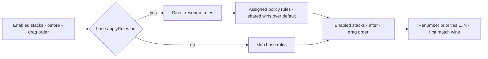

# Stacked Access-Rules-Only Policies (enterprise)

## Goal

A new kind of resource policy containing **only access rules** (no auth stack). Multiple can be
**stacked** onto a resource on top of the rules it already has, without disabling them. Each stack
is positioned **before** or **after** the existing rules, has its own enable toggle, and stacks
**always evaluate** (independent layer, not gated by the resource's `applyRules` flag). Multiple
stacks in the same position group are **drag-reorderable**. Stacks are attached on the resource's
general page (checkbox to apply), shown only when the resource has its own custom rules.
Enterprise feature (same gate as shared policies).

## Verified current state

- `resourcePolicies.scope`: `"global" | "resource"`. Global = shared policies (enterprise,
  `server/private/routers/policy/`). Resource-scoped = inline default policy per resource.
- Rules: `resourceRules` (direct, per resource) + `resourcePolicyRules` (per policy).
- Merge: `getResourceRules()` in `server/db/queries/verifySessionQueries.ts` — direct rules first,
  policy rules offset by `maxDirectPriority + priority`. Duplicated in
  `server/private/routers/hybrid.ts` (`GET /resource/:resourceId/rules` for exit nodes).
- Evaluation: `server/routers/badger/verifySession.ts` sorts merged rules by priority asc, first
  match wins; gated by effective `applyRules` from `getResourceByDomain()` (shared policy wins
  over default policy).
- Enterprise boundary: policy **list/create/delete** routes in
  `server/private/routers/external.ts` carry `verifyValidLicense` +
  `verifyValidSubscription(tierMatrix.resourcePolicies)` + `verifyLimits` +
  `verifyUserHasAction(ActionsEnum.*ResourcePolicy)`. Policy **get/update/rules/mtls** routes are
  in OSS `server/routers/external.ts` (ungated). Resource rule routes
  (`/resource/:resourceId/rule*`) are OSS, `verifyResourceAccess` only.
- UI gating precedent: resource general page gates `SharedPolicySelect` with
  `build !== "oss" && isPaidUser(tierMatrix[TierFeature.ResourcePolicies])`
  (`src/app/[orgId]/settings/resources/public/[niceId]/general/page.tsx:80`).
- Shared policies UI: `src/app/[orgId]/settings/(private)/policies/resources/public/`
  (`ResourcePoliciesTable.tsx` create button; `create/page.tsx` + `CreatePolicyForm`;
  `[niceId]/layout.tsx` tabs general/authentication/rules).
- Drag-and-drop: native HTML5 DnD in `src/components/resource-policy/PolicyAccessRulesTable.tsx`
  (GripVertical handle, `draggable`, `onDragStart/onDragOver/onDrop`) — reuse, no new deps.
- Delete guard: `deleteResourcePolicy` blocks only when `resources.resourcePolicyId` references it.
- Blueprints: `public-policies` (`server/lib/blueprints/resourcePolicies.ts`),
  `ResourcePolicySchema` / `PublicResourceSchema` in `types.ts` (OSS code).

## Data model

1. Extend `resourcePolicies.scope` union with `"rules-only"` (varchar — no column change).
2. New join table **`resourceRulePolicies`** in BOTH `server/db/pg/schema/` and
   `server/db/sqlite/schema/` (main schema — the OSS merge query reads it; keep the two in sync):
   - `id` PK (serial / integer)
   - `resourceId` → resources, `onDelete: cascade`
   - `resourcePolicyId` → resourcePolicies, `onDelete: cascade`
   - `position` varchar `"before" | "after"` (default `"after"`)
   - `sortOrder` integer (ordering within a position group; drag-reorder rewrites it)
   - `enabled` boolean default true
   - unique index on (`resourceId`, `resourcePolicyId`)
3. No migration scripts (drizzle generates them). Add
   `server/setup/migrationNotes/<next-version>.md` (new table + new scope value; no backfill).
   On OSS builds the table exists but stays empty (no routes create rows) — merge code is inert.

## Rule evaluation (confirmed semantics)

Stacks are an **independent rule layer that always evaluates** (own `enabled` toggle +
`before`/`after` position). Base rules (direct + assigned policy) keep today's semantics: they
evaluate only when base effective `applyRules` is on.



- Matcher runs when `baseEffectiveApplyRules OR anyEnabledStack`.
- `includeBaseRules` = base effective `applyRules` (shared policy wins over default, else
  `resources.applyRules`).
- When base is OFF, the merged set contains ONLY enabled stacks.

Pure merge helper `server/lib/resourceRuleMerge.ts` (no DB imports, unit-testable):

```ts
mergeResourceRules({
    stacksBefore,   // enabled, sorted by sortOrder then priority
    direct,         // used only when includeBaseRules
    policy,         // used only when includeBaseRules
    stacksAfter,    // enabled, sorted by sortOrder then priority
    includeBaseRules
}) // -> rules with priority renumbered 1..N
```

Wire into BOTH `getResourceRules()` and the duplicated block in `hybrid.ts`.
`getResourceRules(resourceId)` becomes stack-aware: fetch enabled stack rows joined to
`resourcePolicyRules`, compute `includeBaseRules`, return merged set.

Callers:
- `verifySession.ts` `checkRules`: evaluate when `effectiveApplyRules || hasEnabledStacks`.
- `getResourceByDomain()`: return `applyRules = baseEffectiveApplyRules || hasEnabledStacks`
  (cached 5s, sent to exit nodes → nodes run matcher when stacks exist).
- `hybrid.ts` exit-node route: send merged stack-aware rules.

## API — policy CRUD (enterprise, `server/private/routers/policy/`)

- `createResourcePolicy.ts`: accept `scope: "global" | "rules-only"` (default `global`);
  rules-only rejects auth fields (sso, roles, users, password, pincode, headerAuth, emails,
  mtls), forces `applyRules: true`.
- `listResourcePolicies.ts`: return `scope` in rows; optional `scope` query filter; default
  returns `global` + `rules-only` so the shared policies page lists both kinds.
- `getResourcePolicy` / `updateResourcePolicy` (OSS handlers): include `scope` in response;
  block auth-field updates on rules-only policies.
- `deleteResourcePolicy.ts`: also block when `resourceRulePolicies` rows reference the policy.

## API — stack endpoints

OSS handlers in `server/routers/resource/` (plain AGPL files, no license logic):
- `listResourceRulePolicies.ts` — `GET /resource/:resourceId/rule-policies`
  (stack rows + policy meta: name, niceId, rule count, position, enabled, sortOrder)
- `attachResourceRulePolicy.ts` — `PUT /resource/:resourceId/rule-policy`
  `{ resourcePolicyId, position, enabled }`; validates policy is `rules-only` + same org
- `updateResourceRulePolicy.ts` — `POST /resource/:resourceId/rule-policy/:resourcePolicyId`
  `{ position, enabled, sortOrder }` (drag-reorder posts new sortOrder values)
- `detachResourceRulePolicy.ts` — `DELETE /resource/:resourceId/rule-policy/:resourcePolicyId`

Registration (enterprise-only surface):
- `server/private/routers/external.ts`: register all four with
  `verifyResourceAccess` + `verifyValidLicense` +
  `verifyValidSubscription(tierMatrix.resourcePolicies)` + `verifyLimits` (mirror the
  resource-policy route middleware stack). Import handlers from the OSS `./resource` module
  (private external.ts already imports OSS `resource`).
- `server/private/routers/integration.ts`: register with dual paths
  (`resource/:resourceId/...` + `public-resource/:resourceId/...`), `registry.registerPath`
  per path, same gates.

## Blueprints (repo hard rule)

- `ResourcePolicySchema` (`server/lib/blueprints/types.ts`): add `scope` (allow `rules-only`;
  auth fields optional).
- `PublicResourceSchema`: add `rule-policies`: list of `{ policy: niceId, position, enabled }`.
- Apply: `resourcePolicies.ts` (scope), `publicResources.ts` (stack rows, niceId → id).
- Export: `exportResourceBlueprint.ts` (scope on policies, `rule-policies` on resources).
- Check Newt docker label parsing (`parseDockerContainers.ts` / `parseDotNotation.ts`) for the
  new resource field.

## UI (all strings → `messages/en-US.json` only; Credenza for dialogs)

1. **Shared policies page** (`ResourcePoliciesTable.tsx`): create button becomes a dropdown —
   "New policy" / "New access rules policy" (→ `create?scope=rules-only`). Add kind badge
   column ("Shared" vs "Access rules").
2. **Create page + `CreatePolicyForm`**: read `scope` search param; rules-only mode hides
   `PolicyAuthStackSection` (name + rules only).
3. **Policy detail layout** (`[niceId]/layout.tsx`): hide the "authentication" tab when
   `policy.scope === "rules-only"`.
4. **Resource general page** (`resources/public/[niceId]/general/page.tsx`): new
   `SettingsSection` "Stacked access rule policies" — list of org rules-only policies
   (from `GET /org/:orgId/resource-policies?scope=rules-only`), each with checkbox (enabled) +
   before/after select + drag handle (native HTML5 DnD, same pattern as
   `PolicyAccessRulesTable`). **Rendered only when** the resource has direct rules
   (`resourceRules` count > 0) **and** the existing policy gate passes
   (`build !== "oss" && isPaidUser(tierMatrix[TierFeature.ResourcePolicies])`). Saves via stack
   endpoints.
5. **Resource rules page** (`resources/public/[niceId]/rules/page.tsx`): new box below the
   existing rules section: stacked policies grouped before/after, rules read-only, links to the
   policy's rules tab.
6. `src/lib/queries.ts`: query options for stack list + org rules-only policies.

## Tests

- `server/lib/resourceRuleMerge.test.ts` — group ordering, renumbering, before/after, multiple
  stacks, `includeBaseRules` false (stacks only), empty groups.

## Verification (user-run; do NOT run npm/npx builds — system is resource constrained)

- `npx tsc --noEmit` under `set:oss` AND `set:enterprise` (touches #dynamic territory).
- `npm test`.

## Out of scope

- Private/site resources (no policy system exists for them today).
- Editing stacked policy rules from the resource page (edit on the policy page).
- New ActionsEnum entries (reuse `*ResourcePolicy` actions; stack routes follow the
  resource-policy middleware stack).
- OSS/free availability (rules-only policies are enterprise, same gate as shared policies).

## Resolved decisions

1. Scope value `rules-only`; UI label "Access rules policy".
2. Stacks = independent always-evaluating layer (own toggle + position); base rules keep
   `applyRules` semantics; base OFF → only stacks evaluate.
3. Multiple stacks per position group: drag-to-reorder (native HTML5 DnD, `sortOrder`).
4. Enterprise-only: lives on the shared policies page (second create button), same
   license/subscription gates; no new OSS page, routes, or sidebar entry.
